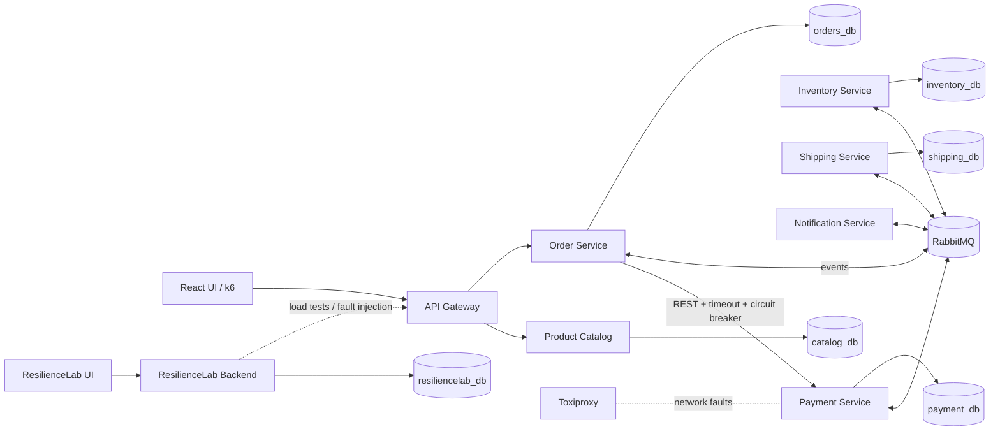
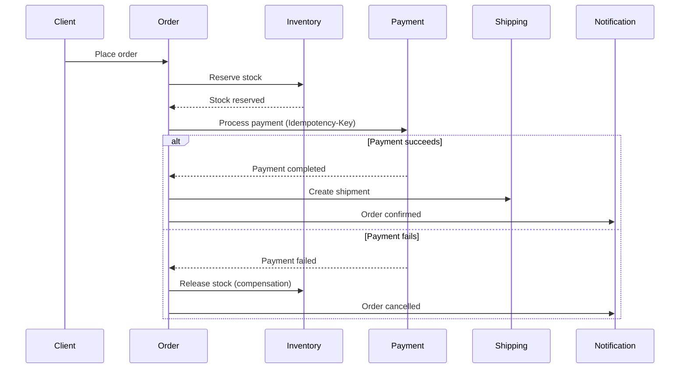

# ResilienceLab

**Distributed Systems Reliability & Performance Engineering Platform**


ResilienceLab is an engineering platform that **configures, runs and analyses reliability and performance experiments** on a distributed system. It ships with its own event-driven e-commerce system, used as a realistic test target.

---

## Table of contents

1. [Why ResilienceLab](#why-resiliencelab)
2. [Goals](#goals)
3. [Architecture](#architecture)
4. [Order workflow (Saga)](#order-workflow-saga)
5. [Reliability patterns](#reliability-patterns)
6. [Experiment scenarios](#experiment-scenarios)
7. [Technology stack](#technology-stack)
8. [Repository structure](#repository-structure)
9. [Getting started](#getting-started)
10. [Engineering workflow](#engineering-workflow)
11. [Roadmap](#roadmap)
12. [Safety and responsible use](#safety-and-responsible-use)
13. [Documentation](#documentation)
14. [Author](#author)
15. [License](#license)

---

## Why ResilienceLab

Distributed systems rarely fail completely. They fail **partially and unpredictably**: a dependency becomes slow, a message is delivered twice, a consumer crashes before acknowledging, a broker disappears for a minute. Such behaviours are seldom tested systematically, so teams discover them in production.

ResilienceLab makes these failure modes **reproducible, measurable and comparable**:

- What happens to an order when the payment service is down?
- Can a customer be charged twice if the same message is replayed?
- Do two buyers of the last item both succeed?
- How do latency percentiles evolve under load, before and after a fault?

## Goals

The project has two parts.

### Part A: E-commerce distributed system (test target)

Six microservices that implement real business logic with synchronous and asynchronous communication:

| Service | Responsibility |
|---|---|
| Product Catalog | Products and prices |
| Order | Order lifecycle and saga orchestration |
| Inventory | Stock management and reservations |
| Payment | Simulated, idempotent payment processing |
| Shipping | Shipment creation after confirmed orders |
| Notification | Customer notifications from domain events |

### Part B: ResilienceLab platform

An independent, modular backend with a React interface to:

- create and configure experiments;
- launch load tests;
- inject network faults and service outages;
- collect metrics and traces;
- visualise results and compare behaviour **before and after** fault injection.

The first version targets only its own system. The design uses a `TargetSystem` abstraction so other **authorised** systems can be supported later.

## Architecture



**Design principles**

- One database per service; no cross-service database access.
- Saga **orchestrated** by the Order Service.
- Transactional Outbox for reliable event publishing.
- Idempotent consumers and idempotent payment processing.
- ResilienceLab is a single modular backend, not a set of extra microservices.

Architecture decisions and their trade-offs are recorded as ADRs in [`docs/adr`](docs/adr/).

## Order workflow (Saga)



## Reliability patterns

| Pattern | Purpose |
|---|---|
| Saga (orchestrated) | Keep data consistent across services without distributed transactions |
| Transactional Outbox | Never lose an event when the broker is unavailable |
| Idempotency | Process a duplicated request or message only once |
| Manual ACK / NACK | Redeliver messages after a consumer crash |
| Retry with exponential backoff | Absorb transient failures |
| Dead Letter Queue | Isolate messages that cannot be processed |
| Timeout | Bound the wait on slow dependencies |
| Circuit Breaker | Stop calling a failing dependency and fail fast |
| Bulkhead | Prevent one dependency from exhausting shared resources |
| Concurrency control | Guarantee a single reservation for the last item |

## Experiment scenarios

Each scenario will be documented with its context, configuration, execution steps, collected metrics, expected result, **observed result** and conclusions in [`docs/experiments`](docs/experiments/).

| # | Scenario | Expected outcome |
|---|---|---|
| 1 | Payment failure | Order not confirmed, stock released |
| 2 | Duplicate payment | Exactly one payment recorded |
| 3 | Consumer crash before ACK | Message redelivered, no double business processing |
| 4 | RabbitMQ outage | Outbox events persisted and published after recovery |
| 5 | Network latency Order → Payment | Controlled behaviour via timeout and circuit breaker |
| 6 | Stock race condition | Only one reservation succeeds for the last item |
| 7 | High load | Throughput, P95/P99 latency and error rate measured |
| 8 | Recovery | Controlled resume and consistent data |

## Technology stack

| Area | Technologies |
|---|---|
| Backend | Java 21, Spring Boot 3, Spring Data JPA, Spring Cloud Gateway, Resilience4j |
| Messaging | RabbitMQ, Spring AMQP |
| Database | PostgreSQL |
| Frontend | React, TypeScript |
| Testing | JUnit 5, Mockito, Testcontainers, k6, Toxiproxy |
| Observability | Prometheus, Grafana, OpenTelemetry, Jaeger |
| DevOps | Docker, Docker Compose, GitHub Actions, JaCoCo, Trivy |
| Cloud | AWS EC2, Terraform (optional) |

## Repository structure

```
ResilienceLab/
├── docs/                 # Architecture, ADRs, API contracts, experiments, deployment
├── services/             # E-commerce microservices (test target)
├── resiliencelab/        # Platform backend and React UI
├── load-tests/           # k6 scenarios
├── infra/                # Docker Compose, monitoring and cloud configuration
├── .env.example          # Required environment variables (no secrets)
└── README.md
```

Directories are added as the corresponding components are built.

## Getting started

### Prerequisites

- JDK 21
- Docker with Docker Compose v2
- Node.js (LTS)
- Git

Maven is not required: each service includes the Maven wrapper.

### Clone

```bash
git clone git@github.com:Elhoussine-07/ResilienceLab.git
cd ResilienceLab
git switch develop
```

### Run the Product Catalog service

```bash
cd services/product-catalog-service
./mvnw spring-boot:run          # Windows: .\mvnw.cmd spring-boot:run
```

```bash
curl http://localhost:8081/actuator/health
```

Expected response: `{"status":"UP","groups":["liveness","readiness"]}`

Instructions for the full stack (infrastructure, all services, load tests, dashboards) are added to this section as each component is delivered.

## Engineering workflow

- **Branches:** `main` (stable), `develop` (integration), short-lived `feature/*`, `fix/*`, `docs/*`, `test/*`.
- **Commits:** [Conventional Commits](https://www.conventionalcommits.org/).
- **Pull requests:** all changes go through a pull request targeting `develop`.
- **Configuration:** environment variables only; no secrets in Git.

See [CONTRIBUTING.md](CONTRIBUTING.md).

## Roadmap

| Phase | Focus |
|---|---|
| 1 | Repository foundations, infrastructure (PostgreSQL, RabbitMQ), six microservices, order workflow |
| 2 | Saga, Transactional Outbox, idempotency, ACK/NACK, retry, DLQ, Resilience4j, concurrency tests |
| 3 | k6 load tests, Toxiproxy fault injection, Prometheus, Grafana, OpenTelemetry, Jaeger |
| 4 | ResilienceLab backend and React dashboard, CI/CD, containerisation, AWS deployment, final documentation |

**Possible extensions:** Terraform automation, Jenkins pipeline, Kubernetes, Kafka.

## Safety and responsible use

Fault injection and load testing must only be used against systems you **own or are explicitly authorised to test**. The first version targets only this project's own test environment. See [SECURITY.md](SECURITY.md).

## Documentation

- [Architecture](docs/architecture/README.md)
- [Architecture Decision Records](docs/adr/)
- [API contracts](docs/api/README.md)
- [Experiments](docs/experiments/README.md)
- [Deployment](docs/deployment/README.md)
- [Development guide](docs/development/README.md)

## Author

**EL HOSSNI LAHOUSSINE**, engineering student at ENSA Agadir
GitHub: [@Elhoussine-07](https://github.com/Elhoussine-07)

## License

Released under the [MIT License](LICENSE).
