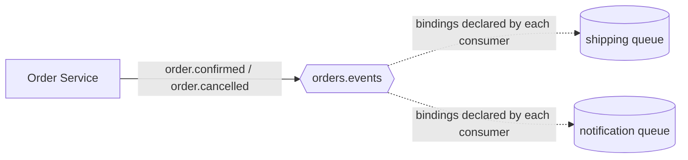

# API documentation

## Product Catalog Service

Base URL (local): `http://localhost:8081/api/v1/products`

| Method | Path                              | Description                                               | Success                   | Errors                                     |
| ------ | --------------------------------- | --------------------------------------------------------- | ------------------------- | ------------------------------------------ |
| POST   | `/api/v1/products`                | Create a product                                          | `201` + `Location` header | `400` invalid payload, `409` duplicate SKU |
| GET    | `/api/v1/products?page=0&size=20` | List products (paged, default sort by name, max size 100) | `200`                     |                                            |
| GET    | `/api/v1/products/{id}`           | Get a product                                             | `200`                     | `404`                                      |
| PUT    | `/api/v1/products/{id}`           | Replace a product                                         | `200`                     | `400`, `404`, `409`                        |
| DELETE | `/api/v1/products/{id}`           | Delete a product                                          | `204`                     | `404`                                      |

### Request body (POST, PUT)

```json
{
  "sku": "KEYB-001",
  "name": "Mechanical keyboard",
  "description": "Tenkeyless, brown switches",
  "price": 79.9
}
```

| Field         | Rules                                          |
| ------------- | ---------------------------------------------- |
| `sku`         | required, not blank, max 64 characters, unique |
| `name`        | required, not blank, max 255 characters        |
| `description` | optional, max 1000 characters                  |
| `price`       | required, >= 0, at most 2 decimals             |

### Errors

Errors follow the RFC 9457 Problem Details format. Validation errors add an `errors` map:

```json
{
  "title": "Invalid request",
  "status": 400,
  "detail": "Validation failed",
  "errors": { "name": "must not be blank" }
}
```

## Inventory Service

Base URL (local): `http://localhost:8082/api/v1`

| Method | Path                                     | Description                                                             | Success                       | Errors                                                                       |
| ------ | ---------------------------------------- | ----------------------------------------------------------------------- | ----------------------------- | ---------------------------------------------------------------------------- |
| PUT    | `/stock/{productId}`                     | Create the stock line or set its available quantity                     | `200`                         | `400`                                                                        |
| GET    | `/stock/{productId}`                     | Read available and reserved quantities                                  | `200`                         | `404`                                                                        |
| POST   | `/reservations`                          | Reserve stock for an order line (idempotent on `orderId` + `productId`) | `201` created, `200` replayed | `400`, `404` unknown product, `409` insufficient stock or conflicting replay |
| GET    | `/reservations/orders/{orderId}`         | List the reservations of an order                                       | `200`                         |                                                                              |
| POST   | `/reservations/orders/{orderId}/release` | Release all reservations of an order (idempotent)                       | `200`                         |                                                                              |

Reservation request body:

```json
{ "orderId": "<uuid>", "productId": "<uuid>", "quantity": 2 }
```

Concurrency guarantees: stock updates are single atomic SQL statements, so the available
quantity can never become negative, and replaying a reservation never reserves twice.

## Payment Service

Base URL (local): `http://localhost:8083/api/v1`

| Method | Path                         | Description                                               | Success                         | Errors                                                                                                             |
| ------ | ---------------------------- | --------------------------------------------------------- | ------------------------------- | ------------------------------------------------------------------------------------------------------------------ |
| POST   | `/payments`                  | Process a payment (requires the `Idempotency-Key` header) | `201` processed, `200` replayed | `400` invalid payload or key, `409` order already paid with another key, `422` key reused with a different request |
| GET    | `/payments/{id}`             | Read a payment                                            | `200`                           | `404`                                                                                                              |
| GET    | `/payments/orders/{orderId}` | Read the payment of an order                              | `200`                           | `404`                                                                                                              |

Request body:

```json
{ "orderId": "<uuid>", "amount": 49.9, "currency": "EUR" }
```

A declined payment is a normal business outcome: the response is `201` with `"status": "DECLINED"`
and a `failureReason`. Amounts above `payment.simulation.max-approved-amount` (default 10000.00) are declined.

Guarantees: one payment per idempotency key and one payment per order, enforced by unique
constraints in the database, so concurrent duplicates cannot create two payments.


## Events published by the Order Service

Broker: RabbitMQ. Exchange: `orders.events` (type `topic`, durable). Messages are JSON, persistent
(`delivery_mode 2`), with the AMQP `message_id` set to the event `eventId`.



| Routing key | Event type | Published when |
|---|---|---|
| `order.confirmed` | `OrderConfirmed` | Stock reserved and payment approved |
| `order.cancelled` | `OrderCancelled` | Stock unavailable, payment declined, or a service unavailable |

Payload:

```json
{
  "eventId": "<uuid>",
  "eventType": "OrderConfirmed",
  "occurredAt": "2026-11-20T10:15:30.123456Z",
  "orderId": "<uuid>",
  "customerEmail": "student@example.com",
  "currency": "EUR",
  "totalAmount": 159.80,
  "cancellationReason": null,
  "items": [{ "productId": "<uuid>", "quantity": 2, "unitPrice": 79.90 }]
}
```

`cancellationReason` is one of `STOCK_UNAVAILABLE`, `PAYMENT_DECLINED`, `PAYMENT_UNAVAILABLE`,
`INVENTORY_UNAVAILABLE` for `OrderCancelled`, and `null` for `OrderConfirmed`.

Delivery guarantees of this version: publication is best effort and happens after the order is
committed. If the broker is unavailable at that moment the event is logged and lost (no retry).
Consumers must still be idempotent on `eventId`, because duplicates will exist once retries and the
transactional outbox are added.
