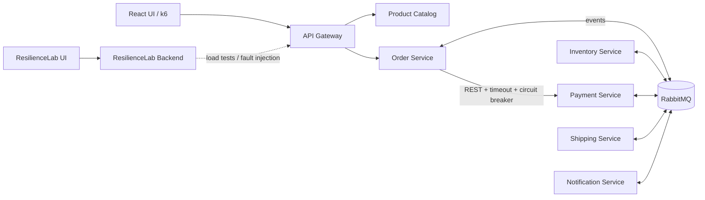

# Architecture

> **Status: target architecture (planned).** This diagram shows the intended design,
> not what is currently implemented.

## Principles

- One database per service; no cross-service database access.
- Saga orchestrated by the Order Service.
- Transactional Outbox for reliable event publishing.
- Idempotent consumers and idempotent payment processing.

Design decisions are recorded in [docs/adr](../adr/).
